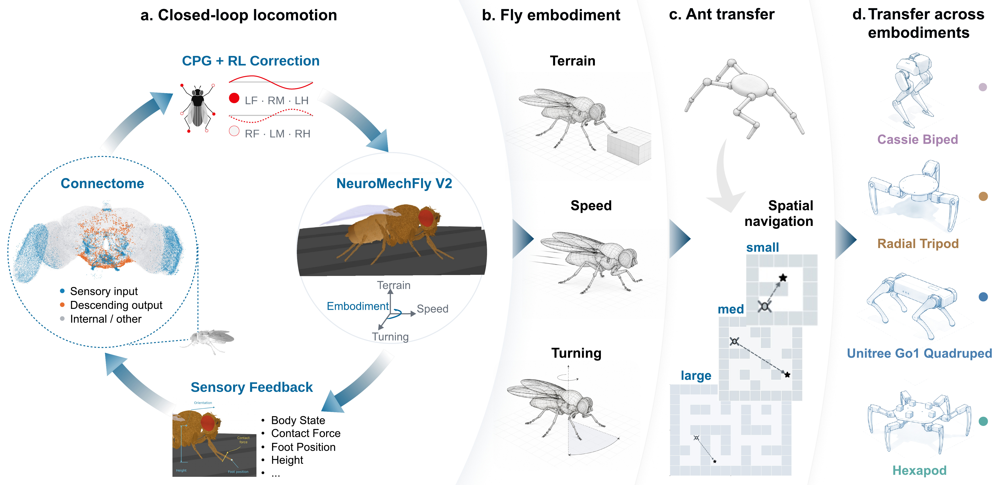

<div align="center">

<h1>FlyControl</h1>
<h2>A <em>Drosophila</em> connectome prior enables adaptable embodied control</h2>

<p>
  Siyu Yu<sup>1,2,3</sup> · Kanglei Zhou<sup>1,3</sup> · Hongwei Yan<sup>1,3</sup> · Xinyi Wang<sup>1</sup><br>
  Sen Song<sup>2,3</sup> · Bo Hong<sup>2,3</sup> · Liyuan Wang<sup>1,3,*</sup>
</p>

<p>
  <sup>1</sup> Department of Psychological and Cognitive Sciences, Tsinghua University<br>
  <sup>2</sup> School of Biomedical Engineering, Tsinghua University<br>
  <sup>3</sup> IDG/McGovern Institute for Brain Research, Tsinghua University<br>
  <sup>*</sup> Correspondence: <a href="mailto:liyuanwang@tsinghua.edu.cn">Liyuan Wang</a>
</p>

<p>
  <a href="pyproject.toml"></a>
  <a href="#install"></a>
  <a href="#install"></a>
  <a href="LICENSE"></a>
</p>

<p>
  <a href="#install">Quick start</a> ·
  <a href="notebooks/README.md">Notebooks</a> ·
  <a href="#manuscript-workflows">Reproduce by figure</a> ·
  <a href="docs/paper-coverage.md">Paper coverage</a> ·
  <a href="docs/validation.md">Validation</a>
</p>

</div>

<p align="center">
  <a href="docs/assets/figure1.jpg">
    
  </a>
</p>

<p align="center">
  <strong>Figure 1 · A shared connectome prior across control demands and bodies.</strong><br>
  Closed-loop fly locomotion → terrain, speed and turning → Ant navigation → transfer across embodiments.<br>
</p>

## Overview

FlyControl uses the adult <em>Drosophila</em> brain connectome as a **fixed recurrent structural prior**, while learning sensory and motor interfaces for embodied control. The experiments study adaptation to terrain, turning and speed demands, investigate the underlying neural mechanisms, and evaluate transfer to maze navigation and different body plans.

This repository provides **from-scratch training, evaluation, neural analysis and plotting** for the main and supplementary experiments. Figure-numbered scripts and matching notebooks share the same six-stage pipeline:

```text
prepare → train → evaluate → probe → analyze → plot
```

Code, fixed configurations, notebooks and documentation live here. Public anatomical inputs and simulator assets are downloaded with version and checksum checks. Policies are trained within each run; checkpoints, full numerical outputs and videos stay outside Git. Notebooks retain compact tables and figure previews from real short tests. The overview image above is a documentation asset from the manuscript.

**Reproduction status.** Short-run and component checks are documented in [Validation](docs/validation.md); full-budget scientific replication has not yet been completed for this code version. [Paper coverage](docs/paper-coverage.md) maps each manuscript result to its workflow and outputs.

## Install

Use Linux and Python 3.10:

```bash
git clone --depth 1 https://github.com/THU-NeuroML/FlyControl.git
cd FlyControl
python3.10 -m venv .venv
source .venv/bin/activate
python -m pip install --upgrade pip
python -m pip install -e '.[test]'
flycontrol list
```

Numerical dependencies are pinned in `pyproject.toml`. Headless rendering needs EGL; alternatively install OSMesa and set `MUJOCO_GL=osmesa`. Native video export additionally requires `ffmpeg` on `PATH`. Training and probes accept `--device cpu` or an available CUDA device; physical evaluations use CPU.

## Reproduce an experiment

Open a [figure-numbered notebook](notebooks/README.md) to view its saved short-test tables and plots directly on GitHub. Each notebook runs all six stages and ends with the corresponding full reproduction command. To regenerate the outputs interactively, install the optional tools once:

```bash
python -m pip install -e '.[notebook]'
python -m ipykernel install --user --name flycontrol --display-name "Python (FlyControl)"
jupyter lab notebooks/
```

Select **Python (FlyControl)** and start with [`06_tripod.ipynb`](notebooks/06_tripod.ipynb). **Run All executes only the short test.** Neural assays and maze prerequisites can still take substantial time despite reduced training budgets.

The same short test can be run from a terminal:

```bash
python scripts/06_tripod.py --run-dir runs/tripod-smoke \
  --smoke --device cpu --workers 1
```

Smoke results are labelled and cannot establish the paper's conclusions. To execute a complete configured experiment:

```bash
python scripts/02_terrain.py --run-dir runs/terrain \
  --device cuda:0 --workers 4
```

Numbered scripts call the same public CLI: `flycontrol run --config terrain` is equivalent to `python scripts/02_terrain.py`. Omitting `--smoke` uses the full fixed protocol. The individual stages are:

```bash
flycontrol prepare  --config terrain --run-dir runs/terrain
flycontrol train    --run-dir runs/terrain --device cuda:0
flycontrol evaluate --run-dir runs/terrain --workers 4
flycontrol probe    --run-dir runs/terrain --device cuda:0
flycontrol analyze  --run-dir runs/terrain
flycontrol plot     --run-dir runs/terrain
```

`prepare` verifies public inputs and builds the required graph and anatomy. `train` produces initial and final checkpoints. `evaluate` generates physical episodes, including failures. `probe` replays recorded inputs and runs the configured neural assays. `analyze` aggregates repeated observations within training models and applies the specified comparison families. `plot` exports editable PDF/SVG panels, PNG previews and their numerical sources.

Each run records effective configurations, source checksums, checkpoint checksums and the numerical environment. Use a new run directory after changing code or configurations. The original research workspace is not required.

## Manuscript workflows

Scripts use `02_`–`06_` for main figures and `S01_`–`S06_` for supplementary-only experiments. Each experiment has a notebook with the same filename stem. Figures derived from the same experiment share one entry.

| Full-run script | Short test | Results | Fixed cohort |
|---|---|---|---|
| [02_terrain.py](scripts/02_terrain.py) | [Notebook](notebooks/02_terrain.ipynb) | Fig. 2 behavior, ER control, temporal sensitivity, blockade and gain planes | Adult / MLP / ER × 20 seeds |
| [03_turning.py](scripts/03_turning.py) | [Notebook](notebooks/03_turning.ipynb) | Fig. 3 behavior, input learning, activity, AN–DN interventions and gain planes | Adult / MLP / ER × 24 seeds × angle/push cohorts |
| [04_speed.py](scripts/04_speed.py) | [Notebook](notebooks/04_speed.ipynb) | Fig. 4, S2 tracking, neural responses, target holds, parameter planes and associations | Adult / MLP × 20 seeds |
| [05_maze.py](scripts/05_maze.py) | [Notebook](notebooks/05_maze.ipynb) | Fig. 5, S7 friction, S8 Large maze | Seven architectures × 20 seeds |
| [06_cassie.py](scripts/06_cassie.py) | [Notebook](notebooks/06_cassie.ipynb) | Fig. 6 Cassie | Adult / MLP × 20 seeds |
| [06_go1.py](scripts/06_go1.py) | [Notebook](notebooks/06_go1.ipynb) | Fig. 6 Go1 | Adult / MLP × 20 seeds |
| [06_tripod.py](scripts/06_tripod.py) | [Notebook](notebooks/06_tripod.ipynb) | Fig. 6, S9 Tripod | Adult / MLP × 20 seeds |
| [06_hexapod.py](scripts/06_hexapod.py) | [Notebook](notebooks/06_hexapod.ipynb) | Fig. 6, S10 Hexapod | Adult / MLP × 20 seeds |
| [S01_terrain_sensitivity.py](scripts/S01_terrain_sensitivity.py) | [Notebook](notebooks/S01_terrain_sensitivity.ipynb) | S1 unit-state and activity-scaled sensitivity | Separate Adult / MLP × 6 seeds |
| [S03_development_terrain.py](scripts/S03_development_terrain.py) | [Notebook](notebooks/S03_development_terrain.ipynb) | Ten terrain contrasts in S3's joint statistical family | Adult / larva × 6 seeds |
| [S03_development_turning.py](scripts/S03_development_turning.py) | [Notebook](notebooks/S03_development_turning.ipynb) | S3 Adult/larva direction and angle control | Adult / larva × 6 seeds per task |
| [S04_development_speed.py](scripts/S04_development_speed.py) | [Notebook](notebooks/S04_development_speed.ipynb) | S4 dynamic speed and perturbation protocols | Adult / larva × 6 seeds |
| [S05_banc_sensitivity.py](scripts/S05_banc_sensitivity.py) | [Notebook](notebooks/S05_banc_sensitivity.ipynb) | S5 initial/final readout sensitivity and matched controls | Adult / BANC-DN / BANC-motor / ER × 6 seeds |
| [S06_banc_recovery.py](scripts/S06_banc_recovery.py) | [Notebook](notebooks/S06_banc_recovery.ipynb) | S6 message substitution and closed-loop recovery | BANC-DN / BANC-motor × 3 seeds |

Two comparisons combine experiments:

```bash
flycontrol combine-development --terrain runs/development-terrain \
  --turning runs/development-turning --output runs/development-combined
flycontrol combine-bodies --run-dirs runs/cassie runs/tripod runs/go1 runs/hexapod \
  --output runs/bodies-combined
```

These require complete cohorts. The developmental command preserves all 22 comparisons; the body command uses equal weights over seven conditions and corrects across four bodies.

To execute the whole fixed campaign, use `bash scripts/00_reproduce_all.sh cuda:0 4 runs/paper`. This launches full training and is computationally substantial. See [protocol details](docs/reproduction.md) for dependency chains, sample units and interpretation.

## Figures, tables and videos

Results are written to `runs/<experiment>/analysis/` and `figures/`. `figures/paper/` contains quantitative panels, with each panel's source values and aggregation recorded. These are regenerated scientific displays, not copies of the manuscript's finished page layouts.

```bash
python scripts/01_materials.py --output runs/materials
flycontrol replay --run-dir runs/turning --video 1 --output runs/videos/01
```

`materials` exports an editable controller overview and Tables S1–S4 configuration records. `replay` uses the 20 supplementary-caption recipes in `configs/videos.json` and writes native clips for each method/condition. Selection is fixed to the first configured training seed and registered initial state; the clips are illustrations, not population evidence. See [video mapping](docs/videos.md) for numbering and the existing published archive.

## Structure

```text
configs/                 Experiment presets, numerical recipes, public-input manifests
src/flycontrol/
  cli.py, pipeline.py    Commands and stage integrity
  inputs.py, connectomes/ Verified public inputs, graphs and anatomical annotations
  engines/              Isolated policies, trainers and physics adapters
  experiments/
    fig1/ ... fig6/      Main-figure implementations, including Ant navigation in fig5/
    supp_s1/            Terrain sensitivity
    supp_s3/            Adult/larva terrain and turning
    supp_s4/            Adult/larva speed
    supp_s5/            BANC readout sensitivity
    supp_s6/            BANC regional recovery
    shared/             Common workflow, paths, statistics and speed evaluation
  analysis/             Shared behavior/neural statistical dispatch
  plotting/             Common panels, trajectories and native video rendering
scripts/                 Figure-numbered full-run entries; 00_reproduce_all.sh runs the campaign
notebooks/               One short test per experiment; matching figure-numbered names
tests/                   Integrity and numerical regression checks
docs/                    Protocol, coverage, validation and the manuscript overview image
```

The [source index by figure](src/flycontrol/experiments/README.md) maps every main and supplementary figure to its implementation. S2 shares `fig4/`, S7–S8 share `fig5/`, and S9–S10 share `fig6/`; these figures reuse the same experiment cohorts.

The four body experiments share policy components, PPO training and orchestration through `engines/common/`. Their adapters retain different physics and control interfaces, including Tripod's matched feedback branch and Hexapod's CPG. Supplementary and developmental fly protocols retain separate engine versions because their observation scaling, anatomical partitions or recurrent updates differ. Some implementation duplication remains; see the [architecture notes](docs/architecture.md) for the boundaries and current tradeoffs.

## Version

The current code version is **0.1.0**, as declared in [pyproject.toml](pyproject.toml). The documented execution environment is **Linux with Python 3.10**. Each run records its effective configurations, source checksums and numerical environment so results can be traced to the code that produced them.

## License and external inputs

See [LICENSE](LICENSE) and [third-party notices](THIRD_PARTY_NOTICES.md). Downloaded anatomy, geometry and the public third-party Ant teacher retain their upstream terms. The teacher is a required distillation input, not a FlyControl trained result. Optional future model releases can be hosted separately on Hugging Face; no Hugging Face account or downloaded FlyControl checkpoint is required here.
